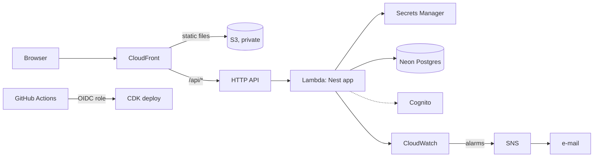

# 🎥 Overview

The main goal of this project was to create an app for finding perfectly matched movies to watch together (e.g. with your fiancée/boyfriend, etc.). <br><br>
Currently, application supports several functionalities:

<ul style="list-style-type: square;">
<li><b>Matching phase</b> - user can vote whether movie seems interesting for him (1.) or rather no (2.), or he doesn't know (3.)</li>
<li><b>Preferences</b> - user can set what kind of movies want to find</li>
<li><b>Find</b> - user can find perfectly matched movie among other users</li>
</ul>

## 🏃‍♂️ Getting started

To install application locally, simply clone this repo and then install all of the dependencies by command

```sh
npm i
```

in the main directory.
<br>
The project is deployed on AWS - try it here: https://dp4vq19ji7yw3.cloudfront.net (the login page has a demo account button).

## 🔐 Authentication

Sign-in goes through Amazon Cognito (Google and Facebook federation, hosted UI, authorization code flow). A demo account is available without any login.

## 🧪 Test exection

Several tests may be executed:

👉 <b> E2E frontend </b> tests with command: <br>

```sh
npm run e2e:front
```

👉 <b> E2E backend </b> tests with command: <br>

```sh
npm run e2e:back
```

👉 <b> Backend unit </b> tests with command: <br>

```sh
npm run units:back
```

# 🏠 Overall architecture

A fullstack Nx monorepo: an Angular frontend and a Nest backend on a Postgres database (Prisma), using the TMDB API for movie data. The libraries are listed in the Tech Stack section; the diagram below shows how it runs on AWS.

# ☁️ AWS architecture



Everything is defined in [`infra/`](infra/README.md) (CDK, TypeScript). Pushes to `main` are deployed by GitHub Actions through an OIDC role, with no stored AWS keys. Decisions: [`docs/adr/`](docs/adr).

# 💻 Tech Stack

Project built thanks to <b>nx version @18.3.4</b>

Used **frontend** main technologies:

|    Dependency    | Version |
| :--------------: | :-----: |
|     Angular      | ^17.3.0 |
| Angular Material | ^17.3.7 |
|       RxJS       | ~7.8.0  |
|   TailwindCSS    | ^3.0.2  |
|    Playwright    | ^1.36.0 |

Used **backend** main technologies:

|       Dependency        | Version |
| :---------------------: | :-----: |
|         NestJS          | ^10.0.2 |
|         Prisma          | ^5.18.1 |
| passport-google-oauth20 | ^2.0.0  |
|        Supertest        | ^7.0.0  |
|          Jest           | ^29.4.1 |

and rest can be found within the repo.
